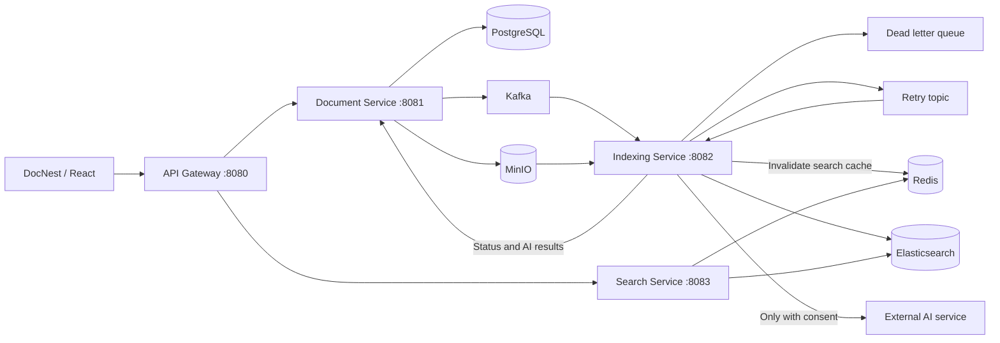

# DocNest

## Zero-cloud-cost local demo

With Docker Desktop running in Linux container mode, run these commands from the project root:

```powershell
powershell.exe -NoProfile -File .\deploy\demo.ps1 -Action Start
powershell.exe -NoProfile -File .\deploy\demo.ps1 -Action Verify -RecordVideo
powershell.exe -NoProfile -File .\deploy\demo.ps1 -Action Stop
```

Open http://localhost:8088. Use `-Build` with Start after changing application source. The demo uses explicit local-only example credentials and isolated `docnest-app` volumes; do not expose it publicly or upload real private documents. Stop preserves data. Verification creates a disposable account and deletes its test document, but retains the account. No cloud deployment or paid AI API is required. See [the demo guide](docs/local-demo.md) for prerequisites, recording and troubleshooting.

## Quality and container deployment

The development checkout includes per-service coverage gates, a full backend JaCoCo report, Checkstyle, SpotBugs, frontend Vitest coverage and a real Playwright document lifecycle test. Run Maven `clean verify` for backend quality checks and `npm run test:coverage` for frontend coverage. Current coverage floors are measured baselines, not a claim that every module reaches 90%.

See [quality standards](docs/quality.md) and [deployment and operations](docs/operations.md). The full application stack is declared in `deploy/compose.yaml`; it uses separate volumes from the local infrastructure setup. The four Java images and React/Nginx image have been built locally and the browser acceptance test passed. This does not constitute a cloud deployment. Publication uses the separate `.publish` checkout; always check the remote commit and its CI results rather than assuming local edits are published.

Document storage and full-text search with asynchronous indexing, optional AI summaries, and user preferences. The website is named **DocNest**.

- Backend repository: `backend/distributed-document-search-engine-main`
- Frontend repository: `frontend/distributed-document-search-engine-ui-main`

The local backend and frontend checkouts retain their independent upstream Git history. The published [RedBone12/DocNest](https://github.com/RedBone12/DocNest) repository contains both source directories as a single project. Its root workflow, `.github/workflows/ci.yml`, runs backend tests, frontend build/lint/tests and Compose validation. Local upstream remotes are preserved. Local edits are not automatically published: the current folder can contain changes that are not yet on GitHub.

Based on [21Priyanshu's backend](https://github.com/21Priyanshu/distributed-document-search-engine) and [frontend](https://github.com/21Priyanshu/distributed-document-search-engine-ui). DocNest extends those projects; upstream attribution is retained.

## Current features

- Email/password registration and sign-in, Remember me, password recovery, password changes, owner-scoped documents, and revocable JWT sessions.
- Upload/download/delete, actual upload-transfer progress, and asynchronous lifecycle updates.
- Paginated document library and full-text search with tags/date filters and no-results states.
- Optional external AI summaries and tags, with explicit consent and separate AI status.
- Bounded indexing retries, failure reasons, DLQ information and final failed states.
- English Settings for AI defaults, summary visibility, list density and five color themes. Preferences are saved per account in the current browser, not synced across devices.
- Mobile document cards, keyboard focus indicators and accessible dialog/drawer interactions.

## Architecture and document flow



Sign in → upload to MinIO and save metadata in PostgreSQL → publish a Kafka event → extract text and optionally analyze it → index in Elasticsearch → invalidate cached search results → mark the document READY. Failures retry up to three total processing attempts, then go to the DLQ with a persisted FAILED state when the status update succeeds. Search is owner-scoped; deletion removes storage/metadata and publishes an event to remove the search entry and invalidate cache.

## Quick start (PowerShell)

Install Java 17+, Maven, Docker Desktop and Node.js 22. Start Docker Desktop.
These launchers target Windows PowerShell. Docker must use Linux containers and Compose v2 with `--wait` support. On macOS/Linux the application components can run, but these Windows launch commands require adaptation.

From this workspace directory, create configuration **only if it does not already exist**:

```powershell
if (-not (Test-Path .\backend\distributed-document-search-engine-main\.env)) {
    Copy-Item .\backend\distributed-document-search-engine-main\.env.example .\backend\distributed-document-search-engine-main\.env
}
```

Edit that `.env` and replace the placeholders. Required: `POSTGRES_USER`, `POSTGRES_PASSWORD`, `MINIO_ROOT_USER`, `MINIO_ROOT_PASSWORD`, and `JWT_SECRET` (a random secret with at least 32 UTF-8 bytes). Keep the JWT secret identical across services. Optional `OPENAI_API_KEY` stays server-side. Never commit `.env` or put secrets into `VITE_` variables.

Start infrastructure, wait for successful completion, then start the four backends:

```powershell
powershell.exe -NoProfile -ExecutionPolicy Bypass -File .\start-infra.ps1
powershell.exe -NoProfile -ExecutionPolicy Bypass -File .\start-backend.ps1
```

Infrastructure comes first. The launcher waits for healthy containers; Document Service checks/creates the MinIO bucket when the backend starts.
The launcher reuses a cached default MinIO image, or builds the pinned upstream source when no default image is cached and no custom `MINIO_IMAGE` is supplied. First-time builds need network access and may take longer. Kafka startup has bounded recovery for stale Zookeeper broker registration.
The backend launcher skips occupied ports; stop old service processes before relaunching changed Java code.
It prints launcher PIDs and writes logs to `backend/distributed-document-search-engine-main/logs/launcher/<run>/`. A listening port is not a full business-health check. Closing the terminal does not stop the background Java processes.

In another terminal:

```powershell
Set-Location .\frontend\distributed-document-search-engine-ui-main
if (-not (Test-Path .env.development)) { Copy-Item .env.example .env.development }
npm.cmd ci
npm.cmd run dev
```

Use the Vite Local address. Frontend `.env.development` needs `VITE_API_BASE_URL=http://localhost:8080`.

If the frontend environment file does not exist, copy `.env.example` to `.env.development` before running Vite. Use the Vite address printed in the terminal rather than assuming the port is always available.

## First account and login

There is no default website username or password. Choose **Create an account** on the sign-in page, enter your email and a password of at least 12 characters (at most 72 UTF-8 bytes), and confirm it. You can show/hide password fields. PostgreSQL and MinIO credentials are **not** website login credentials.

Without **Remember me**, the token is kept in tab session storage and expires after 24 hours; browser session restoration may retain tab storage. With Remember me, it is kept in local storage for up to 30 days. Passwords are never stored by the frontend. Sign-out revokes the current server session; changing/resetting a password revokes all sessions for that account. The UI checks token expiry and server validity, and redirects invalid sessions to sign-in. Temporary server/network outages do not silently delete a valid local session.

Use **Settings → Account Security** to change a password with your current password. **Forgot password?** requests a one-use email link valid for 15 minutes. Recovery requires SMTP; when it is not configured, the page explicitly says so and does not claim an email was sent. Passwords are BCrypt hashes, so the original password cannot be recovered as plaintext. A different account does not inherit existing documents.

On the first backend start after this account update, Hibernate adds nullable recovery fields and a new `auth_sessions` table using the existing development `ddl-auto=update` setting. Existing users/documents are retained, but pre-update tokens have no server session and require signing in again. Do not run an older backend alongside the updated frontend.

### Password recovery email configuration

Add these values to the backend `.env`, using your provider's SMTP settings, then restart document-service:

```dotenv
SMTP_HOST=smtp.example.com
SMTP_PORT=587
SMTP_USERNAME=your-smtp-login
SMTP_PASSWORD=your-smtp-app-password
MAIL_FROM=DocNest <no-reply@example.com>
SMTP_AUTH=true
SMTP_STARTTLS=true
FRONTEND_URL=http://localhost:5173
```

These are examples, not working credentials. The sender must be authorized by your mail provider. `FRONTEND_URL` must match the URL where you open DocNest (including Vite's actual port); use HTTPS outside localhost. Keep SMTP secrets server-side and out of Git. For a local mail-capture server only, set the appropriate host/port and disable auth/TLS if that server requires it; do not disable TLS for public SMTP.

Recovery requests return the same message whether the email is registered or not. Links use random tokens whose SHA-256 hashes, not raw values, are stored in the database. SMTP acceptance does not guarantee delivery to an inbox; check spam/provider settings if mail is missing. Delivery failures log a safe configuration warning, not the secret link. See the backend README for API endpoints and deployment limits.

For a personal **163 Mail** sender, enable SMTP in the mailbox settings and generate a client authorization code. Configure these values in the backend `.env`:

```dotenv
SMTP_HOST=smtp.163.com
SMTP_PORT=465
SMTP_AUTH=true
SMTP_SSL=true
SMTP_STARTTLS=false
SMTP_USERNAME=your-sender@163.com
SMTP_PASSWORD=your-client-authorization-code
MAIL_FROM=your-sender@163.com
FRONTEND_URL=http://localhost:5173
```

Use the full sender address for SMTP_USERNAME and MAIL_FROM, and a client authorization code (not the mailbox login password) for SMTP_PASSWORD. Port 465 uses implicit TLS rather than STARTTLS; certificate/hostname verification remains enabled. The sender can deliver recovery mail to registered users of other email providers. Restart document-service after saving, then confirm actual delivery with an account whose inbox you control. Never commit the completed `.env`.

The configured SMTP mailbox is the site's **sender**, not the recovery recipient. Each user enters their own registered email in Forgot password; the server looks up that account and sends its account-bound link to the stored email. Users do not supply SMTP settings or email passwords, and their email provider does not have to match the sender's. Knowing another user's email does not grant access to the link in that user's inbox.

## Ports

| Component | Default host port |
| --- | --- |
| Frontend (Vite) | 5173 |
| API Gateway | 8080 |
| Document / Indexing / Search services | 8081 / 8082 / 8083 |
| PostgreSQL | 5432 |
| Kafka / Zookeeper | 9092 / 2181 |
| Redis | 6379 |
| Elasticsearch | 9200 |
| MinIO API / Console | 9000 / 9001 |

This is a local development setup, not a hardened public deployment. Ensure ports are available. Another device needs its own configuration and dependencies; existing documents, database contents and browser preferences do not transfer automatically.

See the [backend README](backend/distributed-document-search-engine-main/README.md) for ports, environment variables, architecture, business flows, failure behavior and test commands.
See the [frontend README](frontend/distributed-document-search-engine-ui-main/README.md) for UI behavior and browser preferences.

AI is optional: without OPENAI_API_KEY, documents still index and search normally, while AI status becomes DISABLED. A selected upload can send text externally when AI is configured.

The title and up to 12,000 extracted text characters may be sent to the external service. New requests instruct the model to write summaries and tags in English, regardless of source language, and not follow instructions in document content. These are generation instructions, not a guarantee of output language or prompt-injection immunity. Restart indexing-service after prompt changes. Existing Japanese/Spanish summaries remain unchanged unless analyzed again.

Document status is `UPLOADED`, `INDEXING`, `READY` or `FAILED`; AI status is independently `PENDING`, `COMPLETED`, `FAILED` or `DISABLED`. READY does not necessarily mean AI succeeded. Search does not include failed/unindexed documents; check the library for them.

## Checks and CI

In the backend directory:

```powershell
powershell.exe -NoProfile -ExecutionPolicy Bypass -File .\start-infra.ps1 -ValidateOnly
mvn.cmd -B -ntp test
```

Container E2E tests need Docker and are skipped when it is unavailable. If the default MinIO test image cannot be pulled, use the pinned-source build and quoted Maven image property documented in the backend README. Ordinary tests use simulated AI responses, not your API key; live AI acceptance is a separate opt-in command.

In the frontend directory:

```powershell
npm.cmd run build
npm.cmd run lint
npm.cmd test
```

The published root CI runs backend Maven tests, frontend TypeScript/Vite build, ESLint and frontend tests, plus Docker Compose configuration validation. A past CI success does not validate later local edits; check the run for the exact published commit. Skipped container tests are not passed tests.

## Troubleshooting and current limits

- **Unable to load documents:** check backend launch logs and ports 8080-8083. Restart both document-service and api-gateway after this account update. The updated gateway includes CORS headers on authentication errors and validates revocable user sessions before routing, including search. If authentication fails, sign in again; 503 means a service is unavailable, not that your password is wrong.
- **Changes seem ignored:** the backend launcher skips occupied ports. Stop only the relevant printed launcher PID with `taskkill /PID <launcher-PID> /T`, then run the backend launcher again. Restart Vite if changing environment variables; refresh the page after frontend changes.
- **AI stays pending:** inspect indexing-service logs, Kafka and internal status-update permissions. Old stuck records are not automatically repaired by newer code.
- **AI is DISABLED:** configure the server key if AI is wanted; then restart indexing-service. No key is needed for ordinary storage, indexing and search.
- **DLQ:** failure reporting and bounded retries exist; a manual DLQ replay UI is not implemented. Old messages are not automatically replayed. Full exception details stay in backend logs.
- **Configuration changes:** inherited process environment variables override `.env`. Changing a PostgreSQL password in `.env` does not change the password already stored in an existing database volume.
- **Settings:** user preferences do not modify server credentials or infrastructure configuration. There is no user-facing Kafka/Redis/Elasticsearch administration page.
- **Account deployment limits:** SMTP recovery is implemented, but email ownership verification, MFA, social sign-in and distributed rate limiting are not. The built-in bounded rate limiter is per process and uses the direct remote address (behind the local gateway this is a shared limit); configure trusted proxy/edge limits before public deployment. Only expose the gateway, not internal service ports. Browser-stored bearer tokens require protection against XSS; this is not an HttpOnly-cookie session design.

The Compose project name remains `infra` to reuse existing data volumes. Do not use `docker compose down -v` as a restart command.
