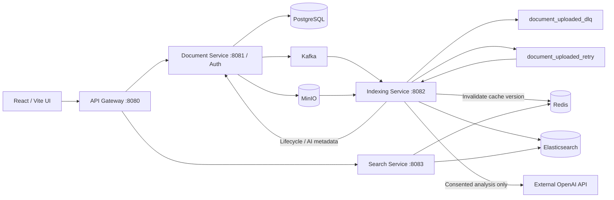

# DocNest Backend

Document storage and full-text search with asynchronous indexing, optional AI summaries, and Redis search caching.

Based on [21Priyanshu/distributed-document-search-engine](https://github.com/21Priyanshu/distributed-document-search-engine). The original frontend is [distributed-document-search-engine-ui](https://github.com/21Priyanshu/distributed-document-search-engine-ui). This checkout adds its own functionality; attribution does not imply ownership of the upstream project.

## Requirements

- JDK 17 or newer and Maven 3.9+ available as `mvn.cmd` on Windows.
- Docker Desktop running with Linux containers and Docker Compose v2.
- Node.js 22 and npm for the separately checked-out frontend.
- These instructions assume local services on the host, not Java services inside Docker.

## First-time configuration

From this backend repository directory:

```powershell
Copy-Item .env.example .env
```

Edit `.env` with your real local database/MinIO credentials and a random JWT secret.
Never commit `.env`. The example contains placeholders, not deployment credentials.
The startup scripts parse simple `NAME=value` lines; they do not execute the file.
Existing process environment variables take precedence. Shell variables created by the script last only for that process.

Generate a JWT secret with at least 32 random bytes:

```powershell
$jwtBytes = New-Object byte[] 32
$rng = [Security.Cryptography.RandomNumberGenerator]::Create()
$rng.GetBytes($jwtBytes)
$rng.Dispose()
[Convert]::ToBase64String($jwtBytes)
```

Paste the generated value into `JWT_SECRET` in your local `.env`. All four services must use the same value. Rotating it invalidates existing tokens.

| Variable | Required | Meaning / default |
| --- | --- | --- |
| POSTGRES_USER | Yes | PostgreSQL account |
| POSTGRES_PASSWORD | Yes | PostgreSQL account password |
| MINIO_ROOT_USER | Yes | Local MinIO account |
| MINIO_ROOT_PASSWORD | Yes | Local MinIO account password |
| JWT_SECRET | Yes | Shared JWT signing key; at least 32 UTF-8 bytes |
| POSTGRES_DB | No | Compose database name; documents_db |
| DATABASE_URL | No | JDBC URL; jdbc:postgresql://localhost:5432/documents_db |
| MINIO_URL | No | Application endpoint; http://localhost:9000 |
| MINIO_BUCKET | No | documents; Document Service checks/creates this bucket on startup |
| MINIO_IMAGE | No | Custom local MinIO image; by default the launcher uses a cached official image or builds the pinned upstream source |
| OPENAI_API_KEY | No | Empty disables AI analysis |
| OPENAI_MODEL | No | gpt-4o-mini |
| OPENAI_ENDPOINT | No | https://api.openai.com/v1/responses |
| OPENAI_REQUEST_TIMEOUT | No | 45s per request |
| OPENAI_MAX_ATTEMPTS | No | 3 |
| OPENAI_RETRY_DELAY | No | 1s |
| VITE_API_BASE_URL | Frontend | Public API address; http://localhost:8080 |
| SMTP_HOST / SMTP_PORT | For recovery | Provider host and port (587 by default) |
| SMTP_USERNAME / SMTP_PASSWORD | For recovery | Provider login/app password; server-side secrets |
| MAIL_FROM | For recovery | Sender address authorized by the provider |
| SMTP_AUTH / SMTP_STARTTLS | No | Both true by default; for implicit TLS use SMTP_SSL=true and SMTP_STARTTLS=false; disable auth only for a trusted local mail-capture server |
| SMTP_SSL | No | false by default; true for implicit TLS on port 465, with SMTP_STARTTLS=false |
| FRONTEND_URL | No | http://localhost:5173; must match actual browser URL, HTTPS outside localhost |
| CORS_ALLOWED_ORIGINS | No | Gateway origin patterns; default localhost/127.0.0.1 ports; use exact HTTPS origins in production |
| AUTH_SERVICE_URL | No | Gateway session validation endpoint base; http://localhost:8081 |

If POSTGRES_DB changes, set DATABASE_URL to the matching database name. Changing POSTGRES_PASSWORD on an existing PostgreSQL volume does **not** change the stored database password; update the database account separately. Preserve the existing `infra` Compose project name and volumes.

## Startup order

1. Configure backend `.env` and open Docker Desktop.
2. Start infrastructure with one command:

```powershell
powershell.exe -NoProfile -ExecutionPolicy Bypass -File .\start-infra.ps1
```

This starts Kafka/Zookeeper, PostgreSQL, MinIO, Elasticsearch and Redis.
The script waits for all six infrastructure health checks. Kafka starts after Zookeeper is healthy. A stale Zookeeper broker registration triggers at most two additional startup attempts, with a 15-second pause between attempts.
There is no MinIO client initialization container. Document Service checks the configured bucket on backend startup, creates it only if missing, and preserves existing contents.
Check infrastructure status:

```powershell
docker compose -p infra -f infra/docker-compose.yml ps -a
docker logs --tail 50 kafka
```

3. Start all four Java services with one command:

```powershell
powershell.exe -NoProfile -ExecutionPolicy Bypass -File .\start-backend.ps1
```

The script loads `.env`, installs the common-events module, and starts document-service, indexing-service, search-service and api-gateway in hidden background processes. Logs are written under `logs/launcher/<run>/`. It checks listening ports, not full business health.

**Occupied ports are skipped, not restarted.** After Java changes, stop the old service before starting it again. Use the printed launcher PID with `taskkill /PID <launcher-PID> /T`; only target processes belonging to this launch. Closing the terminal does not stop background services.

4. In the frontend checkout, create `.env.development` with `VITE_API_BASE_URL=http://localhost:8080`, then:

```powershell
npm.cmd ci
npm.cmd run dev
```

Open the Vite Local address. Vite normally uses 5173. CORS is integrated into the gateway security chain, including authentication failures. Restart the gateway after changing CORS settings.
If starting services manually, first install common-events, then ensure all required environment variables are available in each service's terminal. Spring Boot does not automatically read this repository's `.env`.

## Ports

| Component | Host port | Purpose |
| --- | --- | --- |
| Vite UI | 5173 (normally) | Browser application |
| API Gateway | 8080 | Public application API |
| Document Service | 8081 | Auth, uploads, metadata, lifecycle |
| Indexing Service | 8082 | Kafka consumers and indexing |
| Search Service | 8083 | Search API and caching |
| PostgreSQL | 5432 | Metadata and user accounts |
| Kafka | 9092 | Event broker |
| Zookeeper | 2181 | Local Kafka coordination |
| Redis | 6379 | Search cache |
| Elasticsearch | 9200 | Search index |
| MinIO API | 9000 | File storage |
| MinIO Console | 9001 | Local storage console |

The Compose stack is a local development setup. Redis/Kafka/Elasticsearch are not configured for public exposure.

## Architecture



## Business flows

**Authentication:** the UI provides registration, sign-in, Remember me, password recovery/reset, and a Settings password-change form. Register through POST /auth/register using email/password, then POST /auth/login with optional rememberMe. Passwords are BCrypt hashes. JWT subjects identify document owners. Service tokens carry SERVICE authority for internal updates.

There is no default application account. Registration requires a valid email and a password of at least 12 characters and no more than 72 UTF-8 bytes (BCrypt limit). Database/MinIO credentials are not website login credentials. Login tokens expire after 24 hours, or 30 days with rememberMe. Only token hashes, user IDs and expirations are persisted in auth_sessions. Logout revokes one session; password change/reset revokes all sessions. The document service checks session records; the gateway checks user-session validity with document-service before forwarding any user request, including search. A validation-service outage fails closed with 503. Only expose the gateway publicly, not internal service ports.

The development ddl-auto=update adds nullable recovery columns to app_users and creates auth_sessions without deleting existing data. Old tokens have no session records and require re-login. Rotating JWT_SECRET also invalidates tokens. Do not mix old/new auth-service versions. Browser storage is used for bearer tokens, not HttpOnly cookies; XSS protection and HTTPS remain necessary.

### Recovery and account API

**Personal 163 Mail:** use `smtp.163.com`, port `465`, `SMTP_AUTH=true`, `SMTP_SSL=true` and `SMTP_STARTTLS=false`. SMTP_USERNAME and MAIL_FROM must use the full sender @163.com address. SMTP_PASSWORD is a client authorization code generated in the mailbox's SMTP settings, not the login password. TLS certificate/hostname verification remains enabled. The root README contains a full example.

| Method / path | Behavior |
| --- | --- |
| POST /auth/register | Creates account; 409 for a duplicate email |
| POST /auth/login | email/password/optional rememberMe → token |
| GET /auth/capabilities | passwordResetEnabled; no account details |
| GET /auth/session | Bearer session validity; 401 if invalid |
| POST /auth/logout | Revokes current bearer session |
| POST /auth/forgot-password | email → generic 202; 503 if recovery is unconfigured/busy |
| POST /auth/reset-password | token/password → one-use reset; 400 if invalid/expired |
| POST /auth/change-password | Bearer + currentPassword/newPassword → update and revoke all sessions |

SMTP_HOST and MAIL_FROM must be configured, along with your provider's port/login/password/TLS settings, for recovery to be available. FRONTEND_URL is trusted server configuration, never taken from the request Host header. It must match the website URL and use HTTPS except for localhost. The async worker sends a 256-bit random link valid for 15 minutes; only its SHA-256 hash is stored. The URL uses a fragment, and the frontend removes it from the displayed address, uses no-referrer and posts the token in the request body. A new recovery request replaces the previous token. Row locks prevent concurrent token reuse. Successful reset keeps the same user/document ownership and requires a fresh login.

Unknown/known emails receive the same generic response; no raw token is returned by the API or logged. Async delivery failures clear the pending token and log a safe warning. SMTP acceptance is not proof of inbox delivery. Rate limits are bounded/per-instance, using the direct remote address plus per-email login/recovery limits; behind the local gateway the address limit is shared. Public deployments need trusted-proxy/edge and distributed limits. Email verification, MFA and social login are not implemented.

**Upload:** the UI sends multipart data and an Idempotency-Key. Its progress bar reports actual browser-to-server transfer; 100% transfer can still be waiting for the server's response. Document Service writes the file to MinIO, metadata to PostgreSQL, and confirms publication to document_uploaded. Lifecycle starts as UPLOADED.

**Indexing:** the Kafka consumer writes INDEXING, reads the stored file, extracts text with Tika, optionally requests AI analysis, and writes a document keyed by document ID into Elasticsearch. It invalidates the Redis cache version, then writes READY. The frontend polls the visible page while processing is pending.

**AI:** analysis is optional and requires an upload choice or a separate confirmed action. The title and up to 12,000 extracted text characters may be sent externally. With no OPENAI_API_KEY, ordinary indexing/search still completes and AI status is DISABLED. API errors are reported as AI FAILED; successful text indexing can still become READY. UI preferences only preselect the choice; they do not configure server credentials.

AI requests instruct the model to write summaries and topic tags in English regardless of source language, preserving proper names and technical acronyms. Higher-priority instructions are kept separate from the untrusted document title/content and tell the model not to obey embedded instructions. These are generation rules, not a deterministic language validator or a guarantee against prompt injection. Restart indexing-service after changing them. Previously stored summaries are not automatically regenerated.

**Search:** authenticated queries include page/size, optional AI tags, and date bounds. Elasticsearch restricts results by owner. The frontend uses the returned total for pagination. Redis cache keys include owner, query, filters, pagination and index version, with a 30-second TTL. Redis failure falls back to Elasticsearch. Search only includes successfully indexed documents; inspect the library for failed uploads.

**Failure / DLQ:** an exception increments retryCount. Three failed processing attempts total (initial attempt plus two retries) publish to document_uploaded_dlq. A service-only API persists FAILED, a safe explanation, failure count and timestamp. Pending AI is marked FAILED too. Empty files and documents without readable text get specific failure reasons. The frontend displays the failure and no longer labels it as AI pending.
Full exception details stay in indexing logs; UI messages do not expose secrets or document content.
If final state persistence fails, the record is not acknowledged. Delivery remains at least once, so duplicate DLQ records are possible during outages. Existing DLQ records from before this change are not automatically replayed or repaired. There is no automatic DLQ replay UI in this change.

**Delete:** ownership is checked, metadata and stored content are removed, document_deleted is published, and its consumer removes the Elasticsearch entry and invalidates cached search results.

## Checks and CI

```powershell
mvn.cmd -B -ntp test
.\start-infra.ps1 -ValidateOnly
.\start-backend.ps1 -DryRun
```

GitHub Actions in `.github/workflows/backend-ci.yml` runs Maven tests and Compose configuration validation on pushes and PRs. The Maven reactor includes all four services and common-events. Container pipeline tests use isolated Testcontainers resources (Kafka, Redis, Elasticsearch and MinIO); they do not modify your existing Compose data. They are skipped if Docker is unavailable. CI uses an Ubuntu Docker runner. Inspect test reports rather than treating skipped tests as passed.

Ordinary tests do not call the paid AI API.

CI builds its MinIO test image from upstream commit `07c3a429bfed433e49018cb0f78a52145d4bedeb` using `infra/minio-ci.Dockerfile`, after anonymous pulls failed in this project's CI. The same Dockerfile is also used by the infrastructure launcher as a fallback when the default MinIO image is not cached and no custom MINIO_IMAGE is supplied. An existing cached image is reused; existing volumes are preserved. A first-time source build requires network access for the upstream source, build images and dependencies. To explicitly build the test image locally:

```powershell
docker build -t docnest/minio-ci:2025-09-07 -f infra/minio-ci.Dockerfile infra
mvn.cmd -B -ntp "-Ddocnest.minio.image=docnest/minio-ci:2025-09-07" test
```

The live AI acceptance command is:

```powershell
mvn.cmd -B -ntp -pl services/indexing-service -am -Pai-live verify
```

Set OPENAI_API_KEY before running it. It sends only the dedicated acceptance test document, not a user upload. The frontend repository has a separate workflow for TypeScript/Vite build and ESLint.

## Troubleshooting

- Unable to load documents after an account update: restart document-service and api-gateway and sign in again. The updated frontend clears invalid sessions and the updated gateway includes CORS headers for authentication errors. 503 from session validation means document-service is unavailable; it must be running even for authenticated search.
- AI summary appears in Japanese/Spanish: restart indexing-service to load the English-only generation rules. Previously stored summaries are unchanged; the change does not automatically rerun analysis. Language is requested in the prompt, not deterministically validated.
- Forgotten login: use Forgot password with your registered email. If recovery is unavailable, configure SMTP and restart document-service. No default login exists; do not confuse app credentials with POSTGRES/MINIO environment values.
- UPLOADED + AI PENDING forever: inspect indexing-service logs, Kafka connectivity, and service-token permissions. A 403 during status updates prevents processing from reaching AI.
- Old behavior after recompiling: restart the relevant Java process. The launcher deliberately skips occupied ports.
- Search service unavailable: the UI offers Try again; inspect gateway/search-service and Elasticsearch.
- AI DISABLED: configure OPENAI_API_KEY and restart indexing-service if analysis is wanted.
- Invalid credentials after editing .env: existing shell environment wins; clear or update the relevant variable.
- Startup fails resolving common-events: run the backend startup script, which installs it, or install the module manually.
- Preserve your data: `docker compose down -v` deletes volumes and is not a normal restart command.
