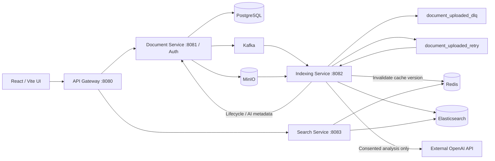

# DocNest Backend

Document storage and full-text search with asynchronous indexing, optional AI summaries, and Redis search caching.

Based on [21Priyanshu/distributed-document-search-engine](https://github.com/21Priyanshu/distributed-document-search-engine). The original frontend is [distributed-document-search-engine-ui](https://github.com/21Priyanshu/distributed-document-search-engine-ui). This checkout adds its own functionality; attribution does not imply ownership of the upstream project.

## Requirements

- JDK 17 or newer and Maven 3.9+ available as `mvn.cmd` on Windows.
- Docker Desktop running with Linux containers and Docker Compose v2.
- Node.js 22 and npm for the separately checked-out frontend.
- These instructions assume local services on the host, not Java services inside Docker.

## First-time configuration

From this backend repository directory:

```powershell
Copy-Item .env.example .env
```

Edit `.env` with your real local database/MinIO credentials and a random JWT secret.
Never commit `.env`. The example contains placeholders, not deployment credentials.
The startup scripts parse simple `NAME=value` lines; they do not execute the file.
Existing process environment variables take precedence. Shell variables created by the script last only for that process.

Generate a JWT secret with at least 32 random bytes:

```powershell
$jwtBytes = New-Object byte[] 32
[Security.Cryptography.RandomNumberGenerator]::Fill($jwtBytes)
[Convert]::ToBase64String($jwtBytes)
```

Paste the generated value into `JWT_SECRET` in your local `.env`. All four services must use the same value. Rotating it invalidates existing tokens.

| Variable | Required | Meaning / default |
| --- | --- | --- |
| POSTGRES_USER | Yes | PostgreSQL account |
| POSTGRES_PASSWORD | Yes | PostgreSQL account password |
| MINIO_ROOT_USER | Yes | Local MinIO account |
| MINIO_ROOT_PASSWORD | Yes | Local MinIO account password |
| JWT_SECRET | Yes | Shared JWT signing key; at least 32 UTF-8 bytes |
| POSTGRES_DB | No | Compose database name; documents_db |
| DATABASE_URL | No | JDBC URL; jdbc:postgresql://localhost:5432/documents_db |
| MINIO_URL | No | Application endpoint; http://localhost:9000 |
| MINIO_BUCKET | No | documents; the initialization container creates this bucket |
| OPENAI_API_KEY | No | Empty disables AI analysis |
| OPENAI_MODEL | No | gpt-4o-mini |
| OPENAI_ENDPOINT | No | https://api.openai.com/v1/responses |
| OPENAI_REQUEST_TIMEOUT | No | 45s per request |
| OPENAI_MAX_ATTEMPTS | No | 3 |
| OPENAI_RETRY_DELAY | No | 1s |
| VITE_API_BASE_URL | Frontend | Public API address; http://localhost:8080 |

If POSTGRES_DB changes, set DATABASE_URL to the matching database name. Changing POSTGRES_PASSWORD on an existing PostgreSQL volume does **not** change the stored database password; update the database account separately. Preserve the existing `infra` Compose project name and volumes.

## Startup order

1. Configure backend `.env` and open Docker Desktop.
2. Start infrastructure with one command:

```powershell
powershell.exe -NoProfile -ExecutionPolicy Bypass -File .\start-infra.ps1
```

This starts Kafka/Zookeeper, PostgreSQL, MinIO, Elasticsearch and Redis.
The `minio-init` container creates the bucket without deleting existing data.
Check that the servers are ready and `minio-init` exited with code 0:

```powershell
docker compose -p infra -f infra/docker-compose.yml ps -a
docker compose -p infra -f infra/docker-compose.yml logs minio-init
```

3. Start all four Java services with one command:

```powershell
powershell.exe -NoProfile -ExecutionPolicy Bypass -File .\start-backend.ps1
```

The script loads `.env`, installs the common-events module, and starts document-service, indexing-service, search-service and api-gateway in hidden background processes. Logs are written under `logs/launcher/<run>/`. It checks listening ports, not full business health.

**Occupied ports are skipped, not restarted.** After Java changes, stop the old service before starting it again. Use the printed launcher PID with `taskkill /PID <launcher-PID> /T`; only target processes belonging to this launch. Closing the terminal does not stop background services.

4. In the frontend checkout, create `.env.development` with `VITE_API_BASE_URL=http://localhost:8080`, then:

```powershell
npm.cmd ci
npm.cmd run dev
```

Open the Vite Local address. Vite normally uses 5173; the gateway permits the local Vite origin.
If starting services manually, first install common-events, then ensure all required environment variables are available in each service's terminal. Spring Boot does not automatically read this repository's `.env`.

## Ports

| Component | Host port | Purpose |
| --- | --- | --- |
| Vite UI | 5173 (normally) | Browser application |
| API Gateway | 8080 | Public application API |
| Document Service | 8081 | Auth, uploads, metadata, lifecycle |
| Indexing Service | 8082 | Kafka consumers and indexing |
| Search Service | 8083 | Search API and caching |
| PostgreSQL | 5432 | Metadata and user accounts |
| Kafka | 9092 | Event broker |
| Zookeeper | 2181 | Local Kafka coordination |
| Redis | 6379 | Search cache |
| Elasticsearch | 9200 | Search index |
| MinIO API | 9000 | File storage |
| MinIO Console | 9001 | Local storage console |

The Compose stack is a local development setup. Redis/Kafka/Elasticsearch are not configured for public exposure.

## Architecture



## Business flows

**Authentication:** register through POST /auth/register using email/password, then POST /auth/login. Passwords are stored as BCrypt hashes. The UI currently has a login form; new accounts can be created through the registration API. JWT user subjects identify document owners. Service tokens carry SERVICE authority for internal updates.

**Upload:** the UI sends multipart data and an Idempotency-Key. Its progress bar reports actual browser-to-server transfer; 100% transfer can still be waiting for the server's response. Document Service writes the file to MinIO, metadata to PostgreSQL, and confirms publication to document_uploaded. Lifecycle starts as UPLOADED.

**Indexing:** the Kafka consumer writes INDEXING, reads the stored file, extracts text with Tika, optionally requests AI analysis, and writes a document keyed by document ID into Elasticsearch. It invalidates the Redis cache version, then writes READY. The frontend polls the visible page while processing is pending.

**AI:** analysis is optional and requires an upload choice or a separate confirmed action. The title and up to 12,000 extracted text characters may be sent externally. With no OPENAI_API_KEY, ordinary indexing/search still completes and AI status is DISABLED. API errors are reported as AI FAILED; successful text indexing can still become READY. UI preferences only preselect the choice; they do not configure server credentials.

**Search:** authenticated queries include page/size, optional AI tags, and date bounds. Elasticsearch restricts results by owner. The frontend uses the returned total for pagination. Redis cache keys include owner, query, filters, pagination and index version, with a 30-second TTL. Redis failure falls back to Elasticsearch. Search only includes successfully indexed documents; inspect the library for failed uploads.

**Failure / DLQ:** an exception increments retryCount. Three failed processing attempts total (initial attempt plus two retries) publish to document_uploaded_dlq. A service-only API persists FAILED, a safe explanation, failure count and timestamp. Pending AI is marked FAILED too. Empty files and documents without readable text get specific failure reasons. The frontend displays the failure and no longer labels it as AI pending.
Full exception details stay in indexing logs; UI messages do not expose secrets or document content.
If final state persistence fails, the record is not acknowledged. Delivery remains at least once, so duplicate DLQ records are possible during outages. Existing DLQ records from before this change are not automatically replayed or repaired. There is no automatic DLQ replay UI in this change.

**Delete:** ownership is checked, metadata and stored content are removed, document_deleted is published, and its consumer removes the Elasticsearch entry and invalidates cached search results.

## Checks and CI

```powershell
mvn.cmd -B -ntp test
.\start-infra.ps1 -ValidateOnly
.\start-backend.ps1 -DryRun
```

GitHub Actions in `.github/workflows/backend-ci.yml` runs Maven tests and Compose configuration validation on pushes and PRs. The Maven reactor includes all four services and common-events. Container pipeline tests use isolated Testcontainers resources (Kafka, Redis, Elasticsearch and MinIO); they do not modify your existing Compose data. They are skipped if Docker is unavailable. CI uses an Ubuntu Docker runner. Inspect test reports rather than treating skipped tests as passed.

Ordinary tests do not call the paid AI API. The explicit live acceptance profile is:

```powershell
mvn.cmd -B -ntp -pl services/indexing-service -am -Pai-live verify
```

Set OPENAI_API_KEY before running it. It sends only the dedicated acceptance test document, not a user upload. The frontend repository has a separate workflow for TypeScript/Vite build and ESLint.

## Troubleshooting

- UPLOADED + AI PENDING forever: inspect indexing-service logs, Kafka connectivity, and service-token permissions. A 403 during status updates prevents processing from reaching AI.
- Old behavior after recompiling: restart the relevant Java process. The launcher deliberately skips occupied ports.
- Search service unavailable: the UI offers Try again; inspect gateway/search-service and Elasticsearch.
- AI DISABLED: configure OPENAI_API_KEY and restart indexing-service if analysis is wanted.
- Invalid credentials after editing .env: existing shell environment wins; clear or update the relevant variable.
- Startup fails resolving common-events: run the backend startup script, which installs it, or install the module manually.
- Preserve your data: `docker compose down -v` deletes volumes and is not a normal restart command.
